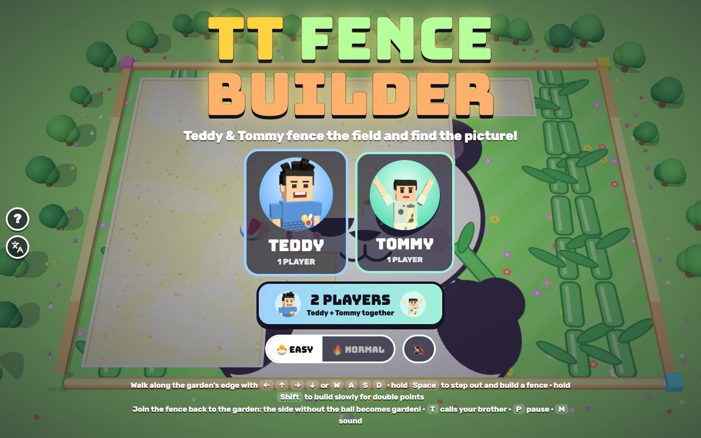

# TT Fence Builder

[](https://adong.github.io/fence-builder-tt/)

Press **?** any time (or tap the round **?** button on the left edge) to see the keys. The game waits while you look.
Tap the language button under it (the A文 icon) to switch between English and 中文; the dashboard and every game remember the choice.

**中文：** 围栏大作战！Teddy 和 Tommy 沿着花园边走，走进空地建围栏。围栏连回花园，没有皮球的那一边就变成你的花园，还会露出下面藏着的图画。占地达到目标百分比（简单 60%，普通 75%），就能看到整幅图画：熊猫、火箭、龙舟、鲸鱼和生日蛋糕。单人或双人一起玩。

## Play

An arcade game in our own style, starring Teddy and Tommy, built with Claude Code from plain JavaScript and Three.js.
A sandy field seen from above, with a hidden picture underneath. Your little builder walks along the edge of the
garden and builds fences out into the open field. Join a fence back to the garden and the side without the big
bouncy beach ball turns into garden, showing that part of the picture. Nobody gets hurt: the ball just makes a fence
boing back, and the sparkly bugs sneeze into confetti and float away. There are no image, model or audio files: the
kids are the shared kit's blocky characters, every picture and texture is painted on a canvas, and every sound is
synthesised.

- **Double-click `index.html`.** It works offline because Three.js and the kit are copied into `kit/`.
- **Send one file:** `dist/fence-builder-tt.html` is the whole game in one page (about 850 KB). Rebuild it after any
  edit: `python3 kit/tools/bundle.py . --name fence-builder-tt`
- The two fonts load from Google Fonts when online. Offline, the game falls back to Arial Black and the system font.
- The name lives in one place, `js/title.js` (`FB.TITLE`, and `FB.TITLE_ZH` = 围栏大作战 for the 中文 logo), plus the
  page `<title>` in `index.html`.
- **Pick a brother** (1 PLAYER) or **2 PLAYERS**, 🐣 EASY (the default) or 🔥 NORMAL, and (once you've reached later
  pictures) START AT PICTURE. Behind the title the brothers fence a field by themselves.

### Building fences

- **Walking:** the builder walks along the edge of the garden (the white line). He can't walk across the middle of
  the garden or into the open field without building.
- **Building:** hold BUILD (Space) and step off the garden into the field. Out there he keeps building wherever he
  walks; no need to keep holding the key. A fence can't cross itself or the other brother's fence.
- **Rolling back:** walk back along your own fence and it rolls back up. A fence that has curled up on itself can
  always be rolled back home, so you can never get stuck.
- **Closing:** step back onto the garden and the fence closes. The fence, and every part of the open field the ball
  isn't in, turns into garden: flowers pop up and that bit of the picture shows. 10 points for each new square.
- **🐢 Slow build:** hold SLOW (Shift) instead: the builder walks at half speed, the fence is gold, and if the whole
  fence was slow the claim scores **double**.
- **The beach ball** bounces around the open field only. If it touches a fence that's still being built (or the
  builder out on it), the fence boings back to where it started: free on EASY, a life on NORMAL.
- **Sparkly bugs** (NORMAL only) patrol the edge of the garden. One that bumps a builder on the edge costs a life:
  it sneezes ("ACHOO!"), bursts into confetti and floats away, and comes back later somewhere else. Out in the field,
  building, you're safe from them.
- **The meter** at the top shows how much is garden and the target: 🌱 26% / 60%.

### Pictures and levels

- **5 hidden pictures**, our own drawings, each in a garden: a panda in the bamboo, a rocket blasting off, a dragon boat
  on the river, a whale in a pond, and a birthday cake at a picnic. Each picture starts with a banner ("What's hiding
  under the field?") and the target.
- **Reaching the target** ends the picture on the spot: the whole picture fades in, "IT'S A PANDA! 🐼", confetti,
  the brother does his signature move, and a bonus (1,000 × the picture number, plus 100 for each % over the target).
  The ball gets faster each picture; on NORMAL there are more bugs.
- **Winning:** after the 5th picture the brothers do their signature moves (Teddy's Tyson-style boxing and his 🏀 jump
  shot, Tommy's Y pose with peace fingers), confetti, and YOU DID IT! with your score, the HI-SCORE and PLAY AGAIN.
- **🐣 EASY** (for Tommy, 5): a slower ball, no bugs, a 60% target, and the ball never costs a life (the fence just
  snaps back).
- **🔥 NORMAL** (for Teddy, 8): a faster ball, sparkly bugs (1, 2, 2, 3, 3), a 75% target, 3 lives.
- **2 players** play together: two builders on one field, shared lives, one team score.
- **Out of lives** (NORMAL): "OH NO!" and **KEEP GOING!** gives you full lives right where you are: your garden
  stays. **↻ START THIS PICTURE AGAIN** (in the pause menu) starts it fresh.
- **HI-SCORE** is kept for each difficulty and shows at the top while you play.

### How it's checked

All the rules live in `js/sim.js` (no Three.js), so `node tools/check.js` plays the real game headlessly in a few
seconds, and `game.check()` runs the same checks in the page. `node tools/check.js --prove` (and `game.prove()`) is the
fail variant: every check runs again with its rule broken on purpose, and passes only if every check fails.

| check | what passes | the broken rule that must fail |
|---|---|---|
| claim | a fence straight across the field claims the side without the ball (ball on the right: the 234 squares on the left plus the 26-post fence; ball on the left: the 728 on the right); a little 3 × 2 box off the edge claims its 9 posts and 6 squares inside, 150 points | claiming the side with the ball |
| percent | a new field is 0%; the fence across makes it exactly 260 / 988 = 26.32%; a slow box on top makes it 275 / 988 and scores double; the count matches the field square by square | dividing by the whole field instead of the open part |
| ball | in long autopilot games (EASY, NORMAL, 1P, 2P) the ball is inside the open field on every step | a ball that only bounces off the outer edge |
| snap | the ball hitting the middle of an 8-post fence clears every post and puts the builder back where he started (EASY: same lives; NORMAL: one less); the ball bumping the builder at the end of his fence does the same | a ball that goes through fences |
| level | EASY: 57.9% plays on and the fence that makes 60.5% ends the picture on that very step; NORMAL: 73.7% plays on, 76.3% ends it; then the next picture starts at 0%; after the 5th the game is done | a picture that never ends |
| stuck | a fence curled up on itself rolls back home; Tommy, left inside the new garden Teddy just made, steps out to the edge; random key mashing (16 games, 70 s each) always leaves a way to move, and walking builders are always on the edge; the autopilot finishes all 5 pictures (1P and 2P, EASY and NORMAL) | no rolling back; no stepping out to the edge |
| freeze | the brother pops in, tosses a treat, and the ball stays put for exactly 5 s, then bounces on; the 2P high five holds it 3 s | a freeze that doesn't freeze |
| frames | the same keys at the same moments give the same game at 30, 60 and 120 frames a second and at a jumpy frame rate | stepping by the frame time instead of the fixed step |

The rules always step by 1/120 s (`FB.Runner` keeps the leftover time for the next frame), so the frame rate never
changes the game.

**The play check** (`game.playCheck()`, in the page) plays the way a kid does: real `keydown` / `keyup` events on
`window` and pointer events on the touch pad and buttons, never the rules' inputs or the autopilot, and it measures
where each builder really is on the screen (projected through the camera, as drawn):

- → / D move right on the screen, ← / A left, BUILD + ↑ / W up into the field, ↓ / S back down (rolling the fence
  up), on all 5 pictures, as Teddy and as Tommy; in 2 players Teddy's WASD + Space move only Teddy and Tommy's
  arrows + Enter only Tommy;
- Space + ↑ builds across the field and closes it (26% garden, and the HUD says so); Shift builds at half speed for
  double points; a tap shorter than one frame takes exactly one step;
- the pad moves the builder the way it's pushed, BUILD + up steps out into the field, up without BUILD stays on the
  edge; in 2 players the right pad is Tommy's;
- nothing leaves the builder stuck: a snapped fence (EASY and NORMAL), a bug's sneeze, the brother and his freeze,
  standing next to the frozen ball, pause with a key held, the ? panel, losing the window focus, a cancelled finger,
  a curled-up fence rolled back with taps, keep going after running out of lives, the next picture, and in 2 players.

`game.playProve()` runs it again with the keys mirrored and with a stun that never ends: both are caught. All of
these were run in the Browser pane and on `dist/fence-builder-tt.html` from `file://` in headless Chrome
(`URL=file://$PWD/dist/fence-builder-tt.html node tools/shoot.js tools/checks.json /tmp/x 1200 750`).

Test hooks (the Browser pane throttles animation when hidden, so tests drive the game themselves):
`game.start(picture, '1p' | '2p', hero, easy)`, `game.step(seconds, { draw: false })`, `game.call()`,
`game.autopilot()`, `game.state()`, `game.check()`, `game.prove()`, `game.playCheck()`, `game.playProve()`,
`game.demo(picture)`. `index.html?level=3&mode=2p` (or `&hero=tommy&easy=0`) opens a picture directly.

## Controls

| | Keys | Touch |
|---|---|---|
| **1 player** | ← ↑ → ↓ or W A S D walk; hold Space (or Enter or /) to build; hold Shift (or X, Q, .) to build slowly | the pad (bottom left) walks; hold 🚧 BUILD or 🐢 SLOW (bottom right) to step off the garden |
| **2 players**: Teddy | W A S D, Space builds, Left Shift or Q builds slowly | the pad on the left and its BUILD button |
| **2 players**: Tommy | ← ↑ → ↓, Enter or / builds, Right Shift or . builds slowly | the pad on the right and its BUILD button |
| call your brother (1 player) / high five (2 players) | T | the round face button, top right |
| pause / sound | P or Esc / M | ❚❚ / 🔊 at the top |

On a touch screen the field sits between the pad and the buttons (or above them, whichever leaves it bigger), clear
of the kit's round buttons on the left edge. On a phone on its side the HI-SCORE pill hides to give the field more
room. On the title screen: Enter starts one player as the brother you picked last (← → to switch), 2 starts two
players, E switches easy mode.

## Companion

In 1 player, call the other brother any time with **T** (or his face button, top right), as often as you like:

- He pops in on the garden next to you at his buddy size (Tommy is smaller than Teddy), with his name tag, and does
  his signature move.
- He tosses you a treat (🍦 💧 🧃 🍪 🍉 🍌, +100, and a life back on NORMAL if you've lost one): "🍦 ICE CREAM FROM
  TOMMY!".
- Then he points at the beach ball, a trail of sparkles flies over, and the ball **freezes for 5 seconds**: icy, with
  snowflakes, and a ❄️ bar under his button counts down ("TOMMY SAYS: FREEZE, BALL! ❄️"). A frozen ball can't snap
  your fence: build right past it (you just can't walk into it).
- Call again while he's there for another treat and 5 more seconds (up to 12). Then he waves bye and goes.

In 2 players both brothers are already playing, so the button is a **HIGH FIVE**: both cheer, a ✋ and confetti, and
the ball freezes for 3 seconds, then 15 s to wait (shown on the button).

## Files

```
index.html        page, HUD, touch pad and buttons, screens (CSS inline)
js/title.js       the game's name (one place)
js/sim.js         the rules: the grid, walking the edge, fences, rolling back, claiming the side without the ball, the
                  ball, the bugs, lives, pictures, the companion and the high five, the autopilot (FB.Bot) and the
                  fixed-step runner (FB.Runner); no Three.js, so it also runs in Node
js/checks.js      the headless checks and their broken-rule versions (node tools/check.js, game.check(), game.prove())
js/art.js         canvas painting: the 5 hidden pictures, the sandy field, the field texture (picture where it's garden,
                  sand where it's open, a white edge), the beach ball, sparkles, snowflakes, floating words
js/view.js        the Three.js scene: the field, the toy frame and trees, the kids and their mallets, instanced fences,
                  the beach ball and its ice, the sparkly bugs, the brother, effects, the camera fit
js/poses.js       extra poses on top of Kit.people.pose (hammer, oops, cheer, point)
js/sfx.js         sounds made with Kit.sound.tone / hiss (fence-post tok, garden sparkle, boing, ah-choo, icy shimmer, ...)
js/input.js       keys and the touch pad -> what each builder wants (FB.Input)
js/game.js        screens, keyboard and touch, HUD, companion button, toasts, the picture banner, HI-SCORE, the title
                  demo, test hooks
js/playcheck.js   the real-key and touch play check (game.playCheck(), game.playProve())
js/keys.js        the keys the ? panel shows (Kit.help)
js/zh.js          中文: every word on the page, the toasts, the banner, the canvas words, the ? panel (Kit.lang)
tools/check.js    the headless check (node tools/check.js [--quick | --prove])
tools/shoot.js    headless Chrome: screenshots (tools/shots.json) and the in-page checks (tools/checks.json)
kit/              copy of ~/claude-games/kit (python3 ../kit/tools/sync.py .); don't edit it here
docs/             the screenshot
dist/fence-builder-tt.html   the single-page build
```

## Not verified

- **Sound:** every effect goes through `Kit.sound` and follows the kit's one sound switch, but nobody listened: all
  testing was muted.
- **Real touch devices:** the pad and buttons were tested with simulated pointer events at iPad (1024x768), phone
  on its side (740x360) and phone upright (390x844) sizes, not with real fingers. On a phone held upright the field is
  small (about 8 px a square); turn it sideways.
- **Real kids:** the ball speeds, the targets and how long a picture takes (the autopilot needs about a minute a
  picture on EASY; a 5-year-old will take longer) are guesses until Teddy and Tommy play it.
- **Home-screen icon** and **Finder double-click:** the icon is drawn by script like the other games, and the page was
  only opened from `file://` in headless Chrome.
